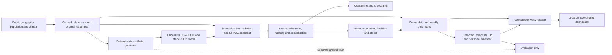

# Architecture and operational design

EpiScope runs as a local Spark application under Ubuntu WSL, with the project and deliverables stored on the Windows D: drive. The design separates original source bytes, trusted analytical records, aggregate decision products and the public browser release. It supports the assignment's heterogeneous data and national-scale transformations while keeping the forecasting and optimization steps auditable.

The truth directory is an evaluation boundary. `analytics/detection.py` and `analytics/forecast.py` never read it. `analytics/evaluate.py` may join detector outputs with truth to measure performance. The synthetic generator's known events must not become model features or rules for identifying particular districts and dates.

## Data layers and publication

| Layer | Contents and responsibilities |
|---|---|
| `data/bronze` | Original encounter/stock/reference bytes, cached public-source responses, SHA256 ingestion manifest and load timestamps. Existing bytes are not edited. |
| `data/lake/silver` | Validated, de-identified encounter records; latest facility registry; valid daily stocks; quarantined records with explicit reasons. |
| `data/lake/gold` | Dense daily and weekly district/disease facts, current district stocks, quality summaries and analytics outputs. |
| `data/lake/lineage` | Immutable JSON dependency manifests addressed by the `lineage_id` stored on every gold record. |
| `dashboard/data` | Bounded JSON release containing only privacy-processed district and division aggregates. |
| `results` | Actual run logs, evaluation CSV/JSON files, performance measurements and recommendation evidence. |

Parquet provides column pruning and efficient compression. Silver encounters are partitioned by ISO epidemiological year. Daily and weekly marts retain ISO year/week semantics at calendar boundaries. The small facility registry is broadcast for joins. AQE and skew handling are enabled, and generated file counts are bounded through repartitioning/coalescing. These are implemented choices; before/after measurements are required before attributing a speed-up to them.

`pipeline.common.publish` writes each replacement table to a staging directory, then publishes the complete result and registers a Spark SQL table. A failed write should leave the previous published table intact. This is local directory publication rather than a distributed transactional lakehouse; concurrent writers are outside the prototype's operating model.

Every gold record carries a `lineage_id`. It resolves to `data/lake/lineage/<lineage_id>.json`, an immutable snapshot of the full bronze ingestion manifest used at publication. The ID hashes a canonical representation of that manifest. This is a conservative set of run-level bronze dependencies, covering reference, facility, encounter and stock inputs; it is not a claim that every listed batch contributed to each individual cell. Daily/weekly `bronze_batch_ids` provide additional onset-group context. The manifest linkage also covers report-count and reporting-quality dependencies that those onset arrays alone cannot express.

Publication occurs table by table. Pipeline marts and analytics can therefore retain different lineage IDs after a pipeline-only refresh; use the orchestrated `all` or `incremental` action when a refreshed analytics/dashboard release is needed. Saved manifests allow each table's input scope to be inspected without implying a cross-table transaction or historical table snapshots. A new Spark session restores SQL tables and temporary views from the persisted Parquet directories.

## Ingestion, quality and incremental semantics

`pipeline.run.ingest` identifies encounter, stock and optional facility files by a bounded schema sample, retains their original bytes and skips previously seen source/checksum pairs. CSV sources with different header orders are grouped separately and then aligned by column name. JSONL, JSON object documents and JSON arrays are read with their recorded parsing mode; recognised manifest sidecars do not enter the clinical feed. The same entry point accepts a new drop without code edits.

`pipeline.quality.clean_encounters` records independently counted reasons for missing identifiers, orphan facilities, invalid geography, dates, ages, sex, disease codes, flags, outcomes and reporting delays. Records violating a rule enter quarantine. Patient identifiers are salted and SHA256-hashed before silver; exact ages become age bands. The deployment salt is supplied through environment configuration or retained outside the repository. It must not appear in Git, exported files or documentation.

Valid records are deduplicated by `encounter_id`, with the latest ingested valid version retained. Revision number, payload hash and batch ID provide deterministic tie handling. Invalid corrections remain quarantined while the preceding valid version can remain active. Duplicate or superseded valid encounter rows receive an explicit quarantine reason. Stock validation likewise retains orphan, invalid and duplicate/superseded examples in its quarantine tables; retained stocks have one row per facility/date. Gold sums the latest facility snapshots by district.

Per-batch quality rows cover encounters and stocks. `rows_in = rows_out + quarantined`; the reported duplicate count is a subset of quarantine, not another category to add to that equation. Independently counted rules may overlap. Rebuilding silver from immutable bronze incorporates late onsets and revisions before regenerating the marts. This favors correctness and simple recovery; incremental ingestion does not imply a minimal-update distributed engine.

The daily mart has every district × required disease × date combination. Zero case counts are distinguished from reporting quality through separate fields. `facility_reporting_fraction` measures active reporting facilities; `completeness` compares that fraction with the preceding 28-day reporting level, and `reporting_maturity` expresses time elapsed under the maximum delay assumption. These are proxies. A zero-encounter facility cannot always be distinguished from an absent report without explicit nil-report acknowledgments.

## Surveillance and forecasting availability

Daily case facts use onset dates, while report-date counts remain available to expose administrative spikes. Surveillance reconstructs a fixed seven-day maturity for every onset cohort. C2 baselines use Spark windows; CUSUM recursion executes per series in Spark grouped pandas. A data-derived late-report guard pauses alarms around suspected backfills. Output onset dates, actual issue dates, quality flags and method scores remain distinct.

Forecasting also starts from report-time availability. Spark aggregates onset-week/report-week cohorts. At each historical Sunday, the model reconstructs recent counts using the retained records' report dates and uses target labels that have matured for three weeks. Climate features at target lags four, six and eight are available for all one-to-four-week horizons. Training standardization and residual calibration use only past information. The last 52 fully mature target weeks form the backtest; the latest three weeks are excluded from scoring rather than treated as complete outcomes.

These as-of counts model report-delay availability for the generated baseline. Silver retains the latest valid encounter version; it does not preserve a bitemporal record of every correction. A later-ingested correction with an earlier report date can therefore change reconstructed historical counts. The current backtest must not be described as an exact reconstruction of overwritten ingestion/revision history or as ACID time travel.

Each district/disease series is small enough for a pandas model fit, and Spark distributes the groups. The national encounter table is never collected to the driver for modelling. Only small aggregate metric tables, calendar products and 64 × six resource demand rows leave Spark for local summaries or the LP solver. Method formulas, interval scoring and primary references are in `analytics/METHODS.md`.

## Allocation, equity and explanation

Four-week upper-bound forecasts and observed admission ratios become explicit resource demand assumptions. The six resource categories are IV saline, NS1 kits, ORS, antimalarials, beds and response-team capacity. Local stocks reduce net need. The HiGHS LP minimizes weighted unmet need under a national purchasing budget, division transport limits and a population-share equity floor.

The scenario grid contains six budgets and four equity floors. `allocations` holds the default policy; `allocation_grid` contains district-level alternatives; `allocation_scenarios` contains their national summaries. The browser changes precomputed policies rather than running an unbounded model. Costs are generic planning units. Continuous bed/team quantities describe capacity equivalents and require an integer dispatch procedure before assigning indivisible physical objects.

## Browser boundary and user experience

`serving.export` reads aggregate gold outputs, applies small-count and coupled suppression, simplifies geography and enforces a combined release-size cap of 10 MB. Raw patient, encounter and facility-line records remain outside the browser. Related totals and rates must be suppressed when they could reveal a hidden count by subtraction. Forecast values are model outputs, and their uncertainty remains visible.

The D3 v7 application coordinates five views: district incidence with alert markers, observed and forecast time series with bands and thresholds, a seasonal heatmap, demand/stock/allocation comparison, and an early-warning ranking. District, disease and time selections share one state. Budget, equity and detector controls use the scenario/score products. Freshness, suspected backfill status and suppression labels explain limitations alongside the numbers. The local server supplies the dashboard and precomputed aggregate data.

## Execution and verification

`run_wsl.sh` establishes the pinned Python environment and limits native numerical threads. `orchestration.cli` executes reference acquisition, generation, bronze/silver/gold processing, analytics and export in dependency order. Stage logs retain real elapsed times, attempts, hardware and failure states. Repeated reference requests use the cache, and checksum-based ingestion makes rerunning an unchanged drop a no-op at the ingestion stage.

Run metadata reads scale, seed and generated volumes from the generation manifest. Scaling experiments use fresh timestamped profile directories and reject pipeline no-ops, so a cached transformation cannot be labelled as a full-pipeline measurement. Cached public reference downloads remain disclosed. The optional container environment uses local Spark and persistent bind mounts; its build and runtime remain untested as recorded in `docs/docker.md`.

Verification covers quality rules, hashing, optimizer constraints, temporal availability, report artefacts, suppression and export size. Scaling runs at SF 0.25, 0.5 and 1 must record encounter volume, actual stage times, output sizes and hardware. The 45-minute SF=1 target is an acceptance criterion, not an established result until measured. Failed or incomplete runs remain visible. Spark event logs support performance inspection; screenshots and optimization results must correspond to the actual application being evaluated.

The executed demo, complete test suite and incremental acceptance results are recorded in `docs/validation.md`. Automated browser checks verify interaction and access behavior on a stated release; they do not replace the two non-CS usability sessions, which have not been conducted. HDFS/MinIO, streaming ingestion, cross-facility episode deduplication, historical transactional snapshots and calibrated SEIR scenarios remain optional gaps.

`team.json` records four approved members and suggested lead areas. Suggested ownership is separate from actual contribution evidence. The final report, policy brief, signed contribution matrix, reflections and presentation are intentionally deferred; this document describes the runnable technical implementation.
